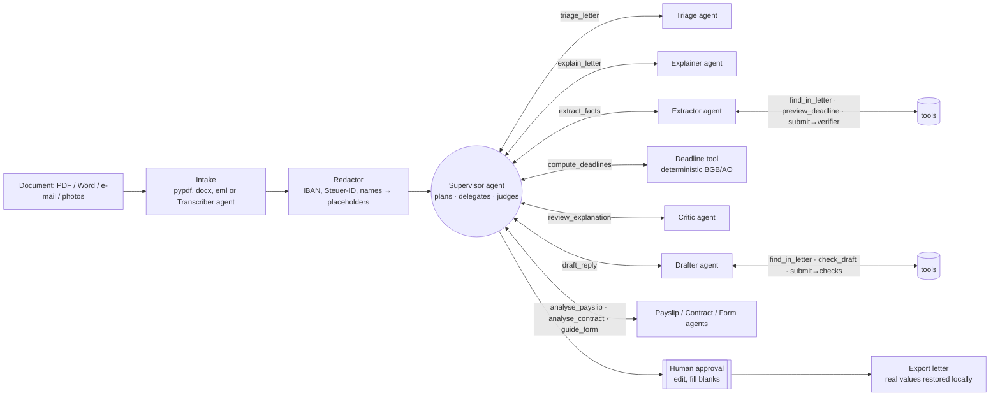

# Briefkasten

**A multi-agent assistant for official German mail.** Upload a letter from the Finanzamt, your Krankenkasse,
the Jobcenter or your landlord. Briefkasten explains it in plain English, works out every deadline with the
actual legal rules (including weekends and your Bundesland's public holidays), checks its own work against the
letter, and drafts a formal German reply that you approve before it goes anywhere. It also explains everyday
documents: payslips (with the arithmetic checked), contracts (with a cancel-by date) and forms to fill in.

## What it handles

| | Examples | What you get |
|---|---|---|
| **Official letters** | Finanzamt, Jobcenter, Krankenkasse, Familienkasse, Ausländerbehörde, Rundfunkbeitrag | Explanation, deadlines, objection or reply draft |
| **Formally served documents** (yellow envelope) | Mahnbescheid, Vollstreckungsbescheid, Bußgeldbescheid, court letters | Deadlines counted from the delivery date on the envelope (`--received`) |
| **Private letters and invoices** | Landlord's Nebenkostenabrechnung, Mahnung, Inkasso | Amounts, payment and objection deadlines |
| **Contracts** | Phone, energy, gym, rental, employment | Costs, term, renewal, clauses to watch out for, cancel-by date |
| **Payslips** | Lohn-/Gehaltsabrechnung | Every line explained; gross → net → payout checked by code |
| **Forms** | Anmeldung, Anträge | Each field explained, attachments, consequences |

Input files: `.pdf` (text or scanned), `.docx`, `.eml` (body and attachments), `.txt`, and photos (`.jpg`, `.png`,
`.webp`, `.heic`). Several files are read as one document in order, e.g. one photo per page.

> Millions of people in Germany get official letters they can't fully read. Missing a one-month
> *Einspruchsfrist* can cost real money, and the deadline is not "one month from the date on the letter".
> Briefkasten is built for that gap.

```text
$ briefkasten demo
 DUE SOON   Finanzamt Musterstadt · decision

Deadlines
  Mon 16.11.2026 (19 days left)  Pay the remaining income tax of 412.00 €
  Thu 19.11.2026 (22 days left)  File an objection (Einspruch) against the assessment [computed]
      ↳ Letter dated Tue 13.10.2026, sent by post: by law it counts as delivered on day 4 after that, Sat 17.10.2026.
      ↳ Sat 17.10.2026 is a Saturday; Sun 18.10.2026 is a Sunday. So it moves to the next working day: Mon 19.10.2026 (§ 108(3) AO).
      ↳ 1 month counted from Mon 19.10.2026 ends on Thu 19.11.2026 (§§ 187, 188 BGB).

Checks  passed · 9 quotes checked against the letter · 1 extraction round(s)
Draft reply (file_objection) – pending approval
  Betreff: Einspruch gegen den Bescheid für 2025 ... Steuernummer [STEUERNUMMER_1]
```

## Architecture

Briefkasten is a supervisor/worker multi-agent system. Every agent is a **ReAct agent**: it reasons, calls
tools, reads the results and decides its next step, until it calls `submit` with a typed result.
The **Supervisor** is itself an LLM agent whose tools are the other agents: it plans the run, delegates,
judges what comes back, and decides whether to redo something with feedback.



| Agent | Tier | Tools | Job |
|---|---|---|---|
| **Supervisor** (`agents/supervisor.py`) | smart | the six specialists below | Plans the run, issues independent work in parallel, reads summaries, asks for revisions (e.g. after the critic), finishes with notes for the user |
| **Triage** | fast | `find_in_letter` | Sender, document type, official decision or not, does it need a reply |
| **Explainer** | smart | `find_in_letter` | Plain-English summary, key points, consequences of ignoring it, glossary; revises on feedback |
| **Extractor** | smart | `find_in_letter`, `preview_deadline` | Deadlines *as rules*, amounts, references, actions, each with a verbatim quote. Its `submit` runs the verifier and rejects ungrounded facts |
| **Critic** | fast | `find_in_letter` | Flags explanation claims the letter doesn't support |
| **Drafter** | smart | `find_in_letter`, `check_draft` | Formal German reply + English translation, with `[blanks]` for facts only you know |
| **Payslip** | smart | `find_in_letter` | Every pay line with its category; `submit` checks the amounts and that gross − taxes − social insurance = net, and net ± other lines = payout |
| **Contract** | smart | `find_in_letter` | Costs, term, renewal, notice, key terms and clauses to watch out for, each quoted |
| **Form** | smart | `find_in_letter` | Each field (label must exist on the form), what to enter, attachments, consequences |
| **Transcriber** | vision | – | Photos and scanned PDFs to text, 4 pages per call |

The Supervisor routes by document type: letters go to explain + extract (+ draft), contracts additionally to the
Contract agent (the Extractor turns the notice period into a cancel-by date), payslips to the Payslip agent, and
forms to the Form agent. It cannot finish until the specialist that fits the document has run.

Code, not models, owns: redaction, deadline arithmetic (`tools/deadlines.py`), grounding checks
(`tools/grounding.py`), per-specialist call budgets, the preconditions on every supervisor tool, and the
approval gate (`orchestrator.py`).

## Design decisions worth talking about

**LLMs extract, code computes.** The Extractor never outputs a date it calculated. It outputs
`{"kind": "after_notification", "months": 1}` plus the sentence it came from. `tools/deadlines.py` then applies
the four-day notification rule (three days for letters dated before 2025, since the Postrechtsmodernisierungsgesetz),
§§ 187/188 BGB month arithmetic, and the weekend/holiday shift for the user's Bundesland. Date maths is exactly the
kind of thing models get subtly wrong, and here a wrong answer means a missed legal deadline.

**Grounding as a hard gate, inside the agent's loop.** Every extracted fact carries a quote. The Extractor
finishes by calling `submit`, which runs the verifier: quotes (whitespace and typography tolerant), amounts in
German number format and dates in German formats must all be in the letter. A rejection is an observation like
any tool result ("amount 283.47 does not appear in the letter"), so the agent searches the letter and fixes it
itself. After one rejection the result is accepted, and any remaining errors go to the Supervisor (which may ask
for one more extraction with instructions) and to the user. Nothing is silently accepted as verified.
The `vermieter_nebenkosten` demo shows a transposed amount being caught and fixed this way.

**Autonomy with guardrails.** The Supervisor chooses what runs and when, but its tools enforce order
(no deadlines before an extraction, no draft before deadlines), each specialist has a call budget, and `submit`
is refused while work is missing, such as an unreviewed explanation, stale deadlines, or a reply the user asked
for. The user's requested intent always overrides the Supervisor's choice.

**Privacy by construction.** Before any model call, three layers replace personal data with stable placeholders:
the names and addresses you list (matched exactly and fuzzily, so OCR misreadings are caught too); names, street
addresses and birthdates found from how German letters are written (`Herrn …`, `Ehefrau: …`, `geb. …`, the name line
of an address block), including every later mention of a detected name, so an unlisted family member is masked
throughout; and patterns for IBANs, tax IDs, insurance numbers, phone numbers and e-mail addresses. Organisations
and their public addresses stay readable, since the agents need to know who wrote and where an objection goes.
The test suite asserts that no prompt contains the raw values. The mapping stays on local disk; real values return
only when an approved reply is exported. With
`BRIEFKASTEN_PROVIDER=openai` pointed at Ollama, nothing leaves your machine at all. With Groq or Anthropic, only the redacted text
is sent.

**Scans and photos are read on your machine.** Redaction needs text, so whatever reads an image sees the unredacted
page. By default that is local Tesseract OCR (`BRIEFKASTEN_IMAGE_READER=ocr`), so the image never leaves your machine;
`local_vision` uses a vision model on a local server such as Ollama (refused if the address isn't local), and `cloud`
sends the image to the provider's vision model, an explicit opt-in that the run report flags. Because OCR misreads
letters (ß becomes "k" or "B"), the names and addresses you list are also matched fuzzily: "Musterstrake 12" and
"Musterstr. 12" are masked as "Musterstraße 12", and restored with your spelling on export.

**Human in the loop, enforced in code.** Drafts can't be exported until approved, and can't be approved while
editorial blanks like `[Nachweis beifügen]` remain. The model is told to leave blanks rather than invent facts about you,
and the Drafter's `submit` rejects redaction placeholders that don't exist in the letter.

**Untrusted input.** The letter is fenced as data in every prompt and agents are told never to follow instructions
inside it.

**Model routing and observability.** Classification and critique use a cheaper model; planning, extraction,
explanation and drafting use a stronger one. Every agent step is traced (agent, model, reasoning text, tools called,
latency, tokens, errors). Invalid tool input and prose without a tool call come back to the model as observations
to correct.

**No framework lock-in.** The agent runtime (`agents/base.py`) is a ~200-line ReAct loop and the providers
speak native tool calling (Anthropic `tool_use`, OpenAI-compatible `tool_calls`) through the standard library, so
the core depends only on `pydantic`, `click` and `pypdf`. Independent tool calls in one turn run concurrently.

## Quick start

```bash
pip install -e ".[web,dev]"

briefkasten demo                         # full pipeline offline, recorded agent replies
briefkasten demo vermieter_nebenkosten   # extractor fixes its own mistake after the verifier rejects it
briefkasten demo gehaltsabrechnung       # payslip: the arithmetic check catches a misfiled line
briefkasten demo handyvertrag            # contract: clauses to watch out for and the cancel-by date
briefkasten process seite1.jpg seite2.jpg --received 06.11.2026   # photos of a served letter, envelope date
briefkasten demo -v                      # show each agent's reasoning and tool calls
briefkasten deadline --letter-date 13.10.2026 --months 1    # pure deadline maths, no AI
```

With a real model:

```bash
cp .env.template .env   # add GROQ_API_KEY (or ANTHROPIC_API_KEY), your Bundesland and names to mask
briefkasten process path/to/letter.pdf --received 2026-10-16 -v   # watch the agents work live
briefkasten process steuerbescheid.pdf --intent file_objection
briefkasten approve <run-id>             # opens the draft in your editor
briefkasten export <run-id> -o einspruch.txt
briefkasten serve                        # web app on http://127.0.0.1:8000
```

While a run is in progress, `process` and `demo` stream each agent step to the terminal: who is thinking,
the reasoning it wrote, which tools it called, rejections it has to fix, and rate-limit waits. The live view goes
to stderr, so `--json` output stays clean; `-q` hides it.

```text
 0:00  supervisor  → explain_letter, extract_facts  0.6s · 952→32 tok
                   “Explaining and extracting are independent, so both run in parallel.”
 0:01    extractor   → submit  1.2s · 831→122 tok
 0:01    extractor   ✗ submit: Rejected. Fix these problems and call submit again: - amounts[0]: amount 283.47 …
 0:02    extractor   → find_in_letter  0.4s · 876→31 tok
 0:09  ⏳ rate limited, retrying in 7s (attempt 2 of 4)
```

Providers (`BRIEFKASTEN_PROVIDER`):

| Provider | Smart / fast / vision defaults | Notes |
|---|---|---|
| `groq` (default in `.env.template`) | `qwen/qwen3.8-27b` for all three | Key from console.groq.com. Qwen makes parallel tool calls and reads images. gpt-oss is not recommended here: on Groq it can't call tools in parallel and often calls a non-existent `json` tool, which stalls the agents. Rejected tool calls are fed back to the agent; 429s wait out the token-per-minute limit (free-tier runs take several minutes) |
| `anthropic` | `claude-sonnet-5-5` / `claude-haiku-5-5` / smart model | |
| `openai` | `llama3.1` | Any OpenAI-compatible server, Ollama by default |

Override any of them with `BRIEFKASTEN_MODEL`, `BRIEFKASTEN_MODEL_FAST` and `BRIEFKASTEN_MODEL_VISION`.

Fully local with Ollama:

```bash
ollama pull qwen2.5:14b
BRIEFKASTEN_PROVIDER=openai BRIEFKASTEN_MODEL=qwen2.5:14b briefkasten process letter.txt
```

The OpenAI-compatible provider also works with OpenAI, vLLM, LM Studio and Gemini
(`OPENAI_BASE_URL=https://generativelanguage.googleapis.com/v1beta/openai`).

### Web app and API

`briefkasten serve` serves an interactive TypeScript UI (React + Vite, in `frontend/`). Build it once:

```bash
cd frontend && npm install && npm run build      # outputs to src/briefkasten/web/dist
briefkasten serve                                 # http://127.0.0.1:8000
npm run dev                                       # or: hot-reloading dev server on :5173, proxying /api to :8000
```

What it does:

- **Live agent graph**: the Supervisor in the middle, specialists around it. Edges light up while a specialist works on a
  delegated job, nodes pulse while thinking and flash amber when a check rejects their work. Click a node to filter the log.
- **Live log** streamed over Server-Sent Events: each agent's reasoning, the tools it called, rejections and how it
  fixed them, rate-limit waits. Samples replay at a watchable pace; every tool runs for real.
- **Document view**: exactly the redacted text the agents saw, masked values as chips. Hover any extracted fact
  (deadline, amount, clause, payslip line) and its quote lights up in the document.
- **Deadlines**: countdowns, a month calendar, "how this date was worked out" step by step, `.ics` export with a reminder.
- **Payslip** waterfall from gross to paid out; **contract** timeline with today, cancel-by date and term end;
  **form** checklist remembered in the browser.
- **Reply draft**: fill each `[blank]` inline, live letter preview, approve unlocks only when nothing is left, then download.
- Dark mode, keyboard navigation, works down to phone width. Without a build, `serve` falls back to a simple HTML page.

| Method | Path | |
|---|---|---|
| `POST` | `/api/runs` | multipart: `file` or `text`, optional `received_on`, `intent`, `bundesland` |
| `POST` | `/api/demo/{name}` | replay a sample without an API key |
| `POST` | `/api/jobs`, `/api/demo/{name}/job?pace=0.7` | start a run in the background (same form fields as `/api/runs`) |
| `GET` | `/api/jobs/{id}/events` | Server-Sent Events: every agent step, then `done` with the run; resumable via `Last-Event-ID` |
| `GET` | `/api/runs`, `/api/runs/{id}` | list / fetch (never includes the redaction map) |
| `POST` | `/api/runs/{id}/approve` | `{ "body_de": "...", "subject_de": "..." }`, 409 while blanks remain |
| `POST` | `/api/runs/{id}/reject` | `{ "reason": "..." }` |
| `GET` | `/api/runs/{id}/letter` | approved reply as a text letter |

### Hosting a public demo

The full app has no user accounts, so `briefkasten serve` refuses to listen on a non-local address unless
demo-only mode is on (or you pass `--allow-public` because it sits behind your own login).

```bash
BRIEFKASTEN_DEMO_ONLY=1 \
BRIEFKASTEN_IMPRINT_URL=https://example.org/impressum \
BRIEFKASTEN_PRIVACY_URL=https://example.org/datenschutz \
briefkasten serve --host 0.0.0.0
```

In demo-only mode the site only replays the fictional sample letters: uploads are refused before the request
body is read, no model API key is needed, runs live in memory for an hour and never touch the disk, visitors
can't list each other's runs, and the page says that its content is AI-generated. The Docker image runs in this
mode by default:

```bash
docker build -t briefkasten . && docker run -p 8000:8000 briefkasten
```

Letting the public analyse *real* letters raises legal questions (Rechtsdienstleistungsgesetz, Steuerberatungsgesetz,
GDPR for tax and health data sent to a US model provider) that need a lawyer, and the app would need accounts and
encrypted, expiring storage first.

## Testing and evaluation

```bash
pytest                       # 103 tests: deadline law, holidays, redaction, grounding, agents, file formats, providers, API
python evals/run_eval.py     # real model against hand-labelled letters
```

The agent tests use `ScriptedLLM`, which replays each agent's turns (its reasoning and tool calls) while every
tool runs live. They cover supervisor planning, parallel delegation, revision after critique, the extractor's
self-repair, budgets and preconditions, refusing to finish early, invalid tool input, failure handling, the approval
gate and PII isolation (including tool results), deterministically. Provider wire formats are tested with stubbed HTTP.

`evals/run_eval.py` scores each run on sender type, document type, letter date, every gold deadline (by kind and
date), amounts owed and grounding, with tokens and latency, and writes a JSON report. Use `--repeats 3` to see
run-to-run variance. Gold labels live in `src/briefkasten/samples/gold/`. All sample letters are fictional.

## Project layout

```
src/briefkasten/
  orchestrator.py      intake, redaction, hand-off to the supervisor, approval gate, export
  agents/              ReAct runtime (base.py), supervisor, triage, explainer, extractor, critic, drafter, transcriber
  tools/               deadlines.py, holidays_de.py, redact.py, grounding.py   (no LLM)
  llm/                 Anthropic + OpenAI-compatible providers with tool calling, router, ScriptedLLM
  models.py            pydantic contracts for every agent output
  cli.py  api.py  web/index.html  report.py  store.py  documents.py
  samples/             fictional letters, gold labels, recorded agent turns
evals/run_eval.py
tests/
```

## Limitations

- Not legal or tax advice. The deadline rules cover Bescheide by post or electronically, private letters, fixed dates,
  formal service (Zustellung) and contract notice periods. Without the envelope date, deadlines for served documents
  use the letter date as the earliest possible start and are marked *estimated*. Special regimes (e.g. procedural
  deadlines inside an ongoing court case, Wiedereinsetzung) are not modelled.
- Holidays cover statutory state-wide days; local ones (e.g. Augsburger Friedensfest) are not included.
- Unlisted names are found from letter conventions, not by understanding the text: a name in running prose without a
  form of address or label ("…wie mit Jonas besprochen…") is only caught if it also appears somewhere the rules
  recognise. Organisations missing from the built-in list may have their address masked too (safe, but less helpful). With `BRIEFKASTEN_IMAGE_READER=cloud`, images reach the provider before
  redaction. Local OCR is weaker than a vision model on crumpled or angled photos; install the German language data
  (`brew install tesseract-lang`) or use `local_vision`.
- Agents need a model with native tool calling. Most current local models (Qwen 2.5, Llama 3.1+) support it
  through Ollama; very small models may wander, which the step limits and budgets contain but cannot fix.
- Real-model runs make more calls than a fixed pipeline (roughly 15-20 steps and ~55k tokens per letter instead of 6 calls).
- The eval set is small (11 hand-labelled documents). Growing it with real, anonymised documents is the most valuable next step.
- Payslips: the arithmetic check assumes the usual layout (gross − taxes − social insurance = net). Unusual items such as
  benefits in kind can make a correct payslip fail the check; it is then shown as an error to look at, not hidden.
- Invoices use the Extractor only; line items are not summed.

## Roadmap

- Calendar export (.ics) for deadlines and reminders before they expire
- E-mail/IMAP and photo-from-phone intake
- More reply types with sender-specific templates (Einspruch, Widerspruch, Ratenzahlung)
- Larger eval set and per-field confidence calibration

MIT licence.
