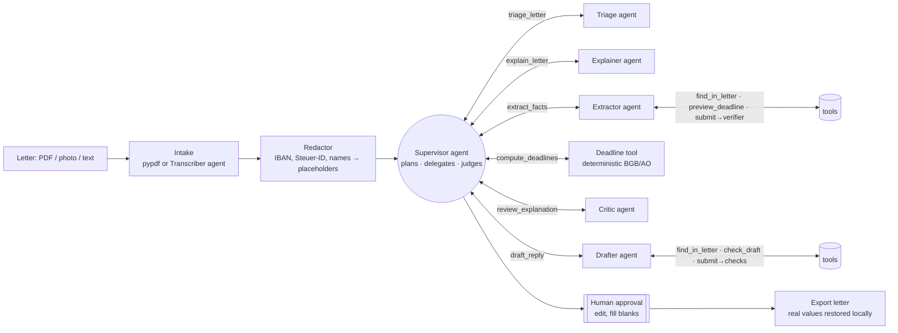

# Briefkasten

**A multi-agent assistant for official German mail.** Upload a letter from the Finanzamt, your Krankenkasse,
the Jobcenter or your landlord. Briefkasten explains it in plain English, works out every deadline with the
actual legal rules (including weekends and your Bundesland's public holidays), checks its own work against the
letter, and drafts a formal German reply that you approve before it goes anywhere.

> Millions of people in Germany get official letters they can't fully read. Missing a one-month
> *Einspruchsfrist* can cost real money, and the deadline is not "one month from the date on the letter".
> Briefkasten is built for that gap.

```text
$ briefkasten demo
 DUE SOON   Finanzamt Musterstadt · decision

Deadlines
  Mon 16.11.2026 (19 days left)  Pay the remaining income tax of 412.00 €
  Thu 19.11.2026 (22 days left)  File an objection (Einspruch) against the assessment [computed]
      ↳ Letter dated Tue 13.10.2026, sent by post: by law it counts as delivered on day 4 after that, Sat 17.10.2026.
      ↳ Sat 17.10.2026 is a Saturday; Sun 18.10.2026 is a Sunday. So it moves to the next working day: Mon 19.10.2026 (§ 108(3) AO).
      ↳ 1 month counted from Mon 19.10.2026 ends on Thu 19.11.2026 (§§ 187, 188 BGB).

Checks  passed · 9 quotes checked against the letter · 1 extraction round(s)
Draft reply (file_objection) – pending approval
  Betreff: Einspruch gegen den Bescheid für 2025 ... Steuernummer [STEUERNUMMER_1]
```

## Architecture

Briefkasten is a supervisor/worker multi-agent system. Every agent is a **ReAct agent**: it reasons, calls
tools, reads the results and decides its next step, until it calls `submit` with a typed result.
The **Supervisor** is itself an LLM agent whose tools are the other agents: it plans the run, delegates,
judges what comes back, and decides whether to redo something with feedback.



| Agent | Tier | Tools | Job |
|---|---|---|---|
| **Supervisor** (`agents/supervisor.py`) | smart | the six specialists below | Plans the run, issues independent work in parallel, reads summaries, asks for revisions (e.g. after the critic), finishes with notes for the user |
| **Triage** | fast | `find_in_letter` | Sender, document type, official decision or not, does it need a reply |
| **Explainer** | smart | `find_in_letter` | Plain-English summary, key points, consequences of ignoring it, glossary; revises on feedback |
| **Extractor** | smart | `find_in_letter`, `preview_deadline` | Deadlines *as rules*, amounts, references, actions, each with a verbatim quote. Its `submit` runs the verifier and rejects ungrounded facts |
| **Critic** | fast | `find_in_letter` | Flags explanation claims the letter doesn't support |
| **Drafter** | smart | `find_in_letter`, `check_draft` | Formal German reply + English translation, with `[blanks]` for facts only you know |
| **Transcriber** | vision | – | Photos and scanned PDFs to text (single call) |

Code, not models, owns: redaction, deadline arithmetic (`tools/deadlines.py`), grounding checks
(`tools/grounding.py`), per-specialist call budgets, the preconditions on every supervisor tool, and the
approval gate (`orchestrator.py`).

## Design decisions worth talking about

**LLMs extract, code computes.** The Extractor never outputs a date it calculated. It outputs
`{"kind": "after_notification", "months": 1}` plus the sentence it came from. `tools/deadlines.py` then applies
the four-day notification rule (three days for letters dated before 2025, since the Postrechtsmodernisierungsgesetz),
§§ 187/188 BGB month arithmetic, and the weekend/holiday shift for the user's Bundesland. Date maths is exactly the
kind of thing models get subtly wrong, and here a wrong answer means a missed legal deadline.

**Grounding as a hard gate, inside the agent's loop.** Every extracted fact carries a quote. The Extractor
finishes by calling `submit`, which runs the verifier: quotes (whitespace and typography tolerant), amounts in
German number format and dates in German formats must all be in the letter. A rejection is an observation like
any tool result ("amount 283.47 does not appear in the letter"), so the agent searches the letter and fixes it
itself. After one rejection the result is accepted, and any remaining errors go to the Supervisor (which may ask
for one more extraction with instructions) and to the user. Nothing is silently accepted as verified.
The `vermieter_nebenkosten` demo shows a transposed amount being caught and fixed this way.

**Autonomy with guardrails.** The Supervisor chooses what runs and when, but its tools enforce order
(no deadlines before an extraction, no draft before deadlines), each specialist has a call budget, and `submit`
is refused while work is missing, such as an unreviewed explanation, stale deadlines, or a reply the user asked
for. The user's requested intent always overrides the Supervisor's choice.

**Privacy by construction.** IBANs, tax IDs, insurance numbers, phone numbers, e-mail addresses and names you list
are replaced with stable placeholders before any model call. The test suite asserts that no prompt contains the raw
values. The mapping stays on local disk; real values return only when an approved reply is exported. With
`BRIEFKASTEN_PROVIDER=openai` pointed at Ollama, nothing leaves your machine at all. With Groq or Anthropic, only the redacted text
(and, for scans, the image) is sent.

**Human in the loop, enforced in code.** Drafts can't be exported until approved, and can't be approved while
editorial blanks like `[Nachweis beifügen]` remain. The model is told to leave blanks rather than invent facts about you,
and the Drafter's `submit` rejects redaction placeholders that don't exist in the letter.

**Untrusted input.** The letter is fenced as data in every prompt and agents are told never to follow instructions
inside it.

**Model routing and observability.** Classification and critique use a cheaper model; planning, extraction,
explanation and drafting use a stronger one. Every agent step is traced (agent, model, reasoning text, tools called,
latency, tokens, errors). Invalid tool input and prose without a tool call come back to the model as observations
to correct.

**No framework lock-in.** The agent runtime (`agents/base.py`) is a ~200-line ReAct loop and the providers
speak native tool calling (Anthropic `tool_use`, OpenAI-compatible `tool_calls`) through the standard library, so
the core depends only on `pydantic`, `click` and `pypdf`. Independent tool calls in one turn run concurrently.

## Quick start

```bash
pip install -e ".[web,dev]"

briefkasten demo                         # full pipeline offline, recorded agent replies
briefkasten demo vermieter_nebenkosten   # extractor fixes its own mistake after the verifier rejects it
briefkasten demo -v                      # show each agent's reasoning and tool calls
briefkasten deadline --letter-date 13.10.2026 --months 1    # pure deadline maths, no AI
```

With a real model:

```bash
cp .env.template .env   # add GROQ_API_KEY (or ANTHROPIC_API_KEY), your Bundesland and names to mask
briefkasten process path/to/letter.pdf --received 2026-10-16 -v
briefkasten process steuerbescheid.pdf --intent file_objection
briefkasten approve <run-id>             # opens the draft in your editor
briefkasten export <run-id> -o einspruch.txt
briefkasten serve                        # web app on http://127.0.0.1:8000
```

Providers (`BRIEFKASTEN_PROVIDER`):

| Provider | Smart / fast / vision defaults | Notes |
|---|---|---|
| `groq` (default in `.env.template`) | `openai/gpt-oss-120b` / `openai/gpt-oss-20b` / `qwen/qwen3.8-27b` | Key from console.groq.com. gpt-oss runs with `reasoning_effort=low` and extra token headroom; its reasoning shows up in the trace. Malformed tool calls (`tool_use_failed`) are retried by the agent loop, and 429s honour `retry-after` |
| `anthropic` | `claude-sonnet-5-5` / `claude-haiku-5-5` / smart model | |
| `openai` | `llama3.1` | Any OpenAI-compatible server, Ollama by default |

Override any of them with `BRIEFKASTEN_MODEL`, `BRIEFKASTEN_MODEL_FAST` and `BRIEFKASTEN_MODEL_VISION`.

Fully local with Ollama:

```bash
ollama pull qwen2.5:14b
BRIEFKASTEN_PROVIDER=openai BRIEFKASTEN_MODEL=qwen2.5:14b briefkasten process letter.txt
```

The OpenAI-compatible provider also works with OpenAI, vLLM, LM Studio and Gemini
(`OPENAI_BASE_URL=https://generativelanguage.googleapis.com/v1beta/openai`).

### Web app and API

`briefkasten serve` starts a FastAPI app with a single-page UI (upload or paste, deadlines with "how this was
worked out", editable draft with approve/reject, download). Endpoints:

| Method | Path | |
|---|---|---|
| `POST` | `/api/runs` | multipart: `file` or `text`, optional `received_on`, `intent`, `bundesland` |
| `POST` | `/api/demo/{name}` | replay a sample without an API key |
| `GET` | `/api/runs`, `/api/runs/{id}` | list / fetch (never includes the redaction map) |
| `POST` | `/api/runs/{id}/approve` | `{ "body_de": "...", "subject_de": "..." }`, 409 while blanks remain |
| `POST` | `/api/runs/{id}/reject` | `{ "reason": "..." }` |
| `GET` | `/api/runs/{id}/letter` | approved reply as a text letter |

Docker: `docker build -t briefkasten . && docker run -p 8000:8000 --env-file .env briefkasten`

## Testing and evaluation

```bash
pytest                       # 52 tests: holidays, deadline law, redaction, grounding, agents, providers, API
python evals/run_eval.py     # real model against hand-labelled letters
```

The agent tests use `ScriptedLLM`, which replays each agent's turns (its reasoning and tool calls) while every
tool runs live. They cover supervisor planning, parallel delegation, revision after critique, the extractor's
self-repair, budgets and preconditions, refusing to finish early, invalid tool input, failure handling, the approval
gate and PII isolation (including tool results), deterministically. Provider wire formats are tested with stubbed HTTP.

`evals/run_eval.py` scores each run on sender type, document type, letter date, every gold deadline (by kind and
date), amounts owed and grounding, with tokens and latency, and writes a JSON report. Use `--repeats 3` to see
run-to-run variance. Gold labels live in `src/briefkasten/samples/gold/`. All sample letters are fictional.

## Project layout

```
src/briefkasten/
  orchestrator.py      intake, redaction, hand-off to the supervisor, approval gate, export
  agents/              ReAct runtime (base.py), supervisor, triage, explainer, extractor, critic, drafter, transcriber
  tools/               deadlines.py, holidays_de.py, redact.py, grounding.py   (no LLM)
  llm/                 Anthropic + OpenAI-compatible providers with tool calling, router, ScriptedLLM
  models.py            pydantic contracts for every agent output
  cli.py  api.py  web/index.html  report.py  store.py  documents.py
  samples/             fictional letters, gold labels, recorded agent turns
evals/run_eval.py
tests/
```

## Limitations

- Not legal or tax advice. The deadline rules cover the common cases (Bescheide by post or electronically,
  private letters, fixed dates). Special regimes, service by *Zustellungsurkunde*, and court deadlines are not modelled.
- Holidays cover statutory state-wide days; local ones (e.g. Augsburger Friedensfest) are not included.
- Names and addresses are only masked if you list them; images are sent to the vision model before redaction
  (use a local model for scans if that matters).
- Agents need a model with native tool calling. Most current local models (Qwen 2.5, Llama 3.1+) support it
  through Ollama; very small models may wander, which the step limits and budgets contain but cannot fix.
- Real-model runs make more calls than a fixed pipeline (roughly 12-16 steps per letter instead of 6).
- The eval set is small (four letters). Growing it with real, anonymised letters is the most valuable next step.

## Roadmap

- Calendar export (.ics) for deadlines and reminders before they expire
- E-mail/IMAP and photo-from-phone intake
- More reply types with sender-specific templates (Einspruch, Widerspruch, Ratenzahlung)
- Larger eval set and per-field confidence calibration

MIT licence.
