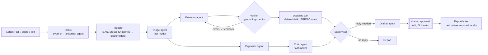

# Briefkasten

**A multi-agent assistant for official German mail.** Upload a letter from the Finanzamt, your Krankenkasse,
the Jobcenter or your landlord. Briefkasten explains it in plain English, works out every deadline with the
actual legal rules (including weekends and your Bundesland's public holidays), checks its own work against the
letter, and drafts a formal German reply that you approve before it goes anywhere.

> Millions of people in Germany get official letters they can't fully read. Missing a one-month
> *Einspruchsfrist* can cost real money, and the deadline is not "one month from the date on the letter".
> Briefkasten is built for that gap.

```text
$ briefkasten demo
 DUE SOON   Finanzamt Musterstadt · decision

Deadlines
  Mon 16.11.2026 (19 days left)  Pay the remaining income tax of 412.00 €
  Thu 19.11.2026 (22 days left)  File an objection (Einspruch) against the assessment [computed]
      ↳ Letter dated Tue 13.10.2026, sent by post: by law it counts as delivered on day 4 after that, Sat 17.10.2026.
      ↳ Sat 17.10.2026 is a Saturday; Sun 18.10.2026 is a Sunday. So it moves to the next working day: Mon 19.10.2026 (§ 108(3) AO).
      ↳ 1 month counted from Mon 19.10.2026 ends on Thu 19.11.2026 (§§ 187, 188 BGB).

Checks  passed · 9 quotes checked against the letter · 1 extraction round(s)
Draft reply (file_objection) – pending approval
  Betreff: Einspruch gegen den Bescheid für 2025 ... Steuernummer [STEUERNUMMER_1]
```

## Architecture



| Component | Kind | Job |
|---|---|---|
| **Supervisor** (`orchestrator.py`) | code | State machine: decides which agent runs next, runs Explainer and Extractor in parallel, bounds the repair loop, owns the approval gate |
| **Triage** | LLM, fast tier | Sender, document type, official decision or not, does it need a reply |
| **Explainer** | LLM, smart tier | Plain-English summary, key points, consequences of ignoring it, glossary |
| **Extractor** | LLM, smart tier | Deadlines *as rules*, amounts, reference numbers, actions, each with a verbatim quote |
| **Verifier** | code | Every quote, amount and date must exist in the letter; failures go back to the Extractor with specific feedback |
| **Critic** | LLM, fast tier | Flags explanation claims the letter doesn't support |
| **Deadline tool** | code | Legal date arithmetic with a step-by-step trace |
| **Drafter** | LLM, smart tier | Formal German reply + English translation, with `[blanks]` for facts only you know |
| **Transcriber** | LLM, vision | Photos and scanned PDFs to text |
| **Redactor** | code | Masks personal identifiers before any model call; restores them only on export |

## Design decisions worth talking about

**LLMs extract, code computes.** The Extractor never outputs a date it calculated. It outputs
`{"kind": "after_notification", "months": 1}` plus the sentence it came from. `tools/deadlines.py` then applies
the four-day notification rule (three days for letters dated before 2025, since the Postrechtsmodernisierungsgesetz),
§§ 187/188 BGB month arithmetic, and the weekend/holiday shift for the user's Bundesland. Date maths is exactly the
kind of thing models get subtly wrong, and here a wrong answer means a missed legal deadline.

**Grounding as a hard gate, with a repair loop.** Every extracted fact carries a quote. The Verifier checks quotes
(whitespace and typography tolerant), amounts in German number format and dates in German formats against the
letter. Errors are sent back to the Extractor once with precise feedback ("amount 283.47 does not appear in the
letter"). If it still fails, the run is marked as not verified rather than silently accepted.
The `vermieter_nebenkosten` demo shows a transposed amount being caught and fixed.

**Privacy by construction.** IBANs, tax IDs, insurance numbers, phone numbers, e-mail addresses and names you list
are replaced with stable placeholders before any model call. The test suite asserts that no prompt contains the raw
values. The mapping stays on local disk; real values return only when an approved reply is exported. With
`BRIEFKASTEN_PROVIDER=openai` pointed at Ollama, nothing leaves your machine at all.

**Human in the loop, enforced in code.** Drafts can't be exported until approved, and can't be approved while
editorial blanks like `[Nachweis beifügen]` remain. The model is told to leave blanks rather than invent facts about you.

**Untrusted input.** The letter is fenced as data in every prompt and agents are told never to follow instructions
inside it.

**Model routing and observability.** Classification and critique use a cheaper model; extraction, explanation and
drafting use a stronger one. Every call is traced (agent, model, attempt, latency, tokens) and invalid JSON gets one
self-repair retry with the validation error.

**No framework lock-in.** The orchestration is ~220 lines of plain Python rather than LangGraph, which keeps the
control flow obvious and every step unit-testable. Providers are called with the standard library, so the core
depends only on `pydantic`, `click` and `pypdf`.

## Quick start

```bash
pip install -e ".[web,dev]"

briefkasten demo                         # full pipeline offline, recorded agent replies
briefkasten demo vermieter_nebenkosten   # shows the verifier repair loop
briefkasten deadline --letter-date 13.10.2026 --months 1    # pure deadline maths, no AI
```

With a real model:

```bash
cp .env.example .env    # add ANTHROPIC_API_KEY, your Bundesland and names to mask
briefkasten process path/to/letter.pdf --received 2026-10-16 -v
briefkasten process steuerbescheid.pdf --intent file_objection
briefkasten approve <run-id>             # opens the draft in your editor
briefkasten export <run-id> -o einspruch.txt
briefkasten serve                        # web app on http://127.0.0.1:8000
```

Fully local with Ollama:

```bash
ollama pull qwen2.5:14b
BRIEFKASTEN_PROVIDER=openai BRIEFKASTEN_MODEL=qwen2.5:14b briefkasten process letter.txt
```

The OpenAI-compatible provider also works with OpenAI, vLLM, LM Studio and Gemini
(`OPENAI_BASE_URL=https://generativelanguage.googleapis.com/v1beta/openai`).

### Web app and API

`briefkasten serve` starts a FastAPI app with a single-page UI (upload or paste, deadlines with "how this was
worked out", editable draft with approve/reject, download). Endpoints:

| Method | Path | |
|---|---|---|
| `POST` | `/api/runs` | multipart: `file` or `text`, optional `received_on`, `intent`, `bundesland` |
| `POST` | `/api/demo/{name}` | replay a sample without an API key |
| `GET` | `/api/runs`, `/api/runs/{id}` | list / fetch (never includes the redaction map) |
| `POST` | `/api/runs/{id}/approve` | `{ "body_de": "...", "subject_de": "..." }`, 409 while blanks remain |
| `POST` | `/api/runs/{id}/reject` | `{ "reason": "..." }` |
| `GET` | `/api/runs/{id}/letter` | approved reply as a text letter |

Docker: `docker build -t briefkasten . && docker run -p 8000:8000 --env-file .env briefkasten`

## Testing and evaluation

```bash
pytest                       # 43 tests: holidays, deadline law, redaction, grounding, pipeline, API
python evals/run_eval.py     # real model against hand-labelled letters
```

The pipeline tests use `ScriptedLLM`, which replays per-agent responses, so they cover routing, the parallel
step, the repair loop, JSON self-repair, failure handling, the approval gate and PII isolation deterministically.

`evals/run_eval.py` scores each run on sender type, document type, letter date, every gold deadline (by kind and
date), amounts owed and grounding, with tokens and latency, and writes a JSON report. Use `--repeats 3` to see
run-to-run variance. Gold labels live in `src/briefkasten/samples/gold/`. All sample letters are fictional.

## Project layout

```
src/briefkasten/
  orchestrator.py      supervisor, repair loop, approval gate, export
  agents/              triage, explainer, extractor, verifier (+critic), drafter, transcriber
  tools/               deadlines.py, holidays_de.py, redact.py, grounding.py   (no LLM)
  llm/                 Anthropic + OpenAI-compatible providers, router, ScriptedLLM
  models.py            pydantic contracts for every agent output
  cli.py  api.py  web/index.html  report.py  store.py  documents.py
  samples/             fictional letters, gold labels, recorded replays
evals/run_eval.py
tests/
```

## Limitations

- Not legal or tax advice. The deadline rules cover the common cases (Bescheide by post or electronically,
  private letters, fixed dates). Special regimes, service by *Zustellungsurkunde*, and court deadlines are not modelled.
- Holidays cover statutory state-wide days; local ones (e.g. Augsburger Friedensfest) are not included.
- Names and addresses are only masked if you list them; images are sent to the vision model before redaction
  (use a local model for scans if that matters).
- The eval set is small (four letters). Growing it with real, anonymised letters is the most valuable next step.

## Roadmap

- Calendar export (.ics) for deadlines and reminders before they expire
- E-mail/IMAP and photo-from-phone intake
- More reply types with sender-specific templates (Einspruch, Widerspruch, Ratenzahlung)
- Larger eval set and per-field confidence calibration

MIT licence.
